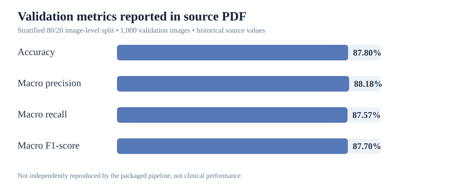
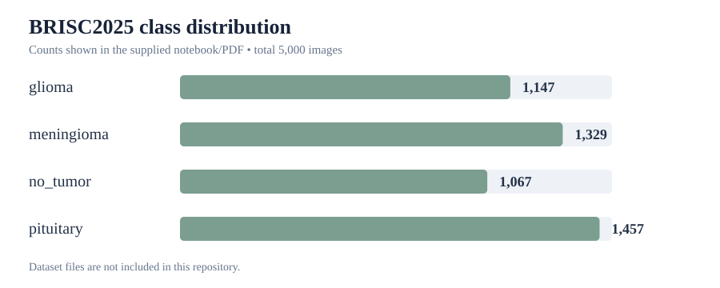
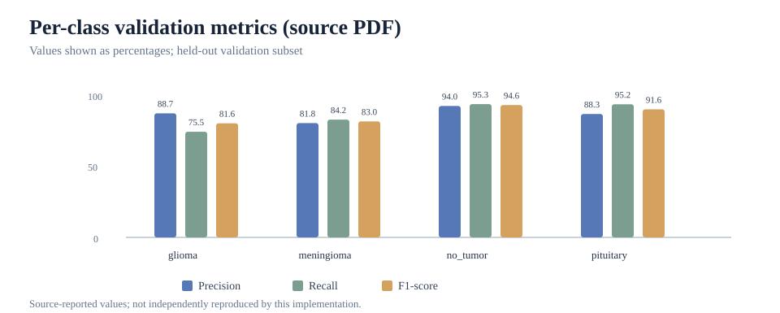
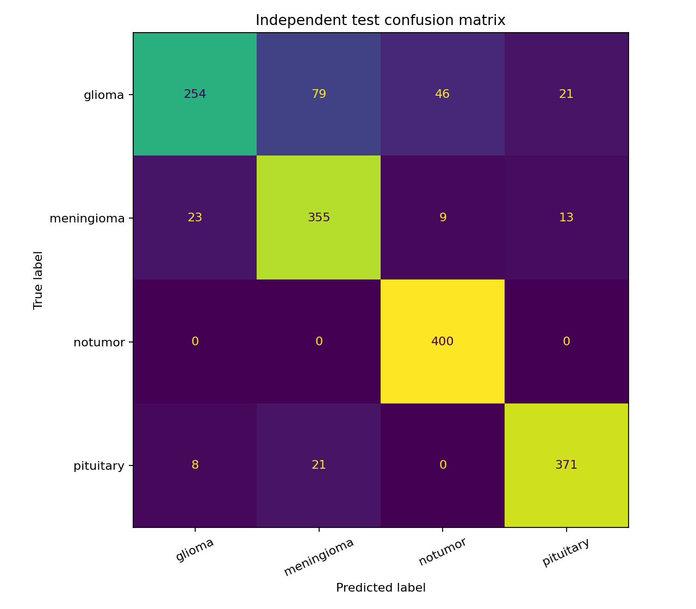
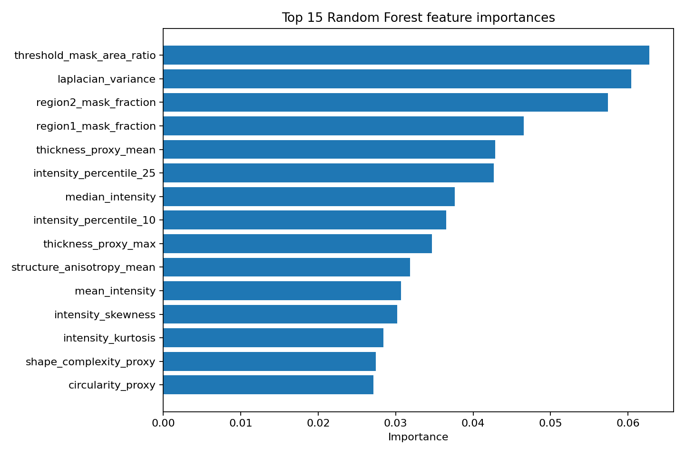

# Brain MRI Classification — Handcrafted Features + Random Forest

**Academic/practice experiment. Not a medical diagnostic tool.** This folder adds a second classical machine-learning workflow to the parent repository. The original experiment compares Gaussian Naive Bayes and SVM using pixel/HOG descriptors; this experiment uses 37 handcrafted intensity, gradient, texture and 2D shape-proxy descriptors with Random Forest.

## Objective

Explore whether image-derived descriptors can discriminate four image-level labels in the BRISC2025 classification dataset: glioma, meningioma, no_tumor, and pituitary.

This is a classification exercise, not tumor detection or segmentation. The Otsu threshold selects a bright connected image region; it is **not** a radiologist-annotated tumor mask. Area, thickness, circularity and complexity are therefore image-region proxies, not verified tumor measurements or clinical biomarkers.

## Pipeline

1. Read grayscale/RGB images from class-named folders.
2. Resize to 224 × 224, normalize intensities, and apply Gaussian smoothing.
3. Build an Otsu threshold region and derive 37 intensity, gradient, texture and shape-proxy descriptors.
4. Make a stratified 80/20 image-level train/validation split (random_state=42).
5. Train StandardScaler + RandomForestClassifier (400 trees, balanced class weights).
6. Save metrics, CSV reports, a model bundle, and visual diagnostics.

## Results transcribed from the source notebook/PDF

The supplied source reports one stratified 80/20 split of 5,000 images (1,000 validation images). These are historical source results, **not independently reproduced by the cleaned script yet**.

| Metric | Source-reported result |
|---|---:|
| Accuracy | **87.80%** |
| Macro precision | **88.18%** |
| Macro recall | **87.57%** |
| Macro F1-score | **87.70%** |

Per-class F1-score reported in the source: glioma 81.60%, meningioma 82.96%, no_tumor 94.64%, pituitary 91.60%.

### Reference visualizations

These SVG charts visualize the numerical values above as reported in the provided source PDF; they are **not fresh model outputs**.








Re-run the code on your downloaded dataset before claiming that these values were reproduced by this implementation. Do not change metrics manually to reach a target. Any 100% result from a synthetic-data smoke test is only a software check and is not a medical-image result.

## Independent test evaluation (October 2026)

A separate evaluation script, `evaluate_independent_test.py`, trains the pipeline on the `Training` directory and evaluates it on the separate `Testing` directory. The independent test set is not used to fit the model.

**Dataset split**
- Training images: 5,600 (1,400 per class)
- Independent test images: 1,600 (400 per class)
- Number of handcrafted features: 37
- Classifier: StandardScaler + RandomForestClassifier

### Overall test results

| Metric | Independent test result |
|---|---:|
| Accuracy | 86.25% |
| Macro precision | 86.67% |
| Macro recall | 86.25% |
| Macro F1-score | 85.74% |

### Per-class results

| Class | Precision | Recall | F1-score | Test images |
|---|---:|---:|---:|---:|
| glioma | 89.12% | 63.50% | 74.16% | 400 |
| meningioma | 78.02% | 88.75% | 83.04% | 400 |
| notumor | 87.91% | 100.00% | 93.57% | 400 |
| pituitary | 91.60% | 92.75% | 92.17% | 400 |

### Independent test visualizations





The confusion matrix shows that the model correctly classified 254 of 400 glioma images (63.5% recall). This limitation must be considered alongside the overall accuracy. The model also confuses some glioma images with meningioma and no-tumor classes.

Feature importance reflects how the fitted Random Forest uses the descriptors for prediction. It does not demonstrate biological causality or clinical significance.

### Reproducing the independent test

Run the following command from the repository root. The dataset must already be downloaded and available in the expected directories.

```powershell
python experiments/structural_morphometrics/evaluate_independent_test.py --train-dir "brain_mri_dataset/Training" --test-dir "brain_mri_dataset/Testing" --output-dir "experiments/structural_morphometrics/reports_independent_test" --random-state 42
```

The script saves the evaluation metrics, per-class classification report, feature importances, and visualization figures in the output directory. Generated model bundles and individual test predictions are excluded from version control.

**Limitations:** This is an educational image-classification experiment, not a diagnostic system. The Otsu-derived region is not a tumor segmentation mask, and the reported performance does not establish clinical validity.

## Dataset

Images are not committed to this repository. Download BRISC2025 from its [dataset page](https://www.kaggle.com/datasets/briscdataset/brisc2025/) and check the dataset terms. The expected folder is the one directly containing one directory per class:

~~~text
classification_task/train/
├── glioma/
├── meningioma/
├── no_tumor/
└── pituitary/
~~~

Do not pass the BRISC2025 parent folder or classification_task folder; pass classification_task/train directly.

## Run on Windows PowerShell

From this folder (experiments/structural_morphometrics):

~~~powershell
python -m venv .venv
.\.venv\Scripts\Activate.ps1
python -m pip install --upgrade pip
python -m pip install -r requirements.txt
python morphometric_pipeline.py --data-dir "D:\datasets\brisc2025\brisc2025\classification_task\train" --output-dir reports
~~~

Replace the example path with your actual dataset location. For a quick smoke test, use a small subset first:

~~~powershell
python morphometric_pipeline.py --data-dir "D:\datasets\brisc2025\brisc2025\classification_task\train" --output-dir reports-smoke --max-images-per-class 10
~~~

**Do not report smoke-test metrics as final model results.** For the full experiment, omit --max-images-per-class.

## Outputs and visualizations

~~~text
reports/
├── classification_report.csv
├── feature_importance.csv
├── feature_table.csv
├── metrics_summary.json
├── model_bundle.joblib
├── validation_predictions.csv
└── figures/
    ├── class_distribution.png
    ├── confusion_matrix.png
    ├── feature_importance.png
    ├── per_class_metrics.png
    ├── sample_images.png
    └── validation_examples.png
~~~

The validation-example figure overlays the Otsu region and gradient map. It is a visual diagnostic only and must not be labelled as tumor segmentation. Random Forest feature importances are predictive model statistics, not evidence of biological causality.

## Tests

~~~powershell
python -m pytest -q
~~~

## Limitations

- The source PDF uses a held-out split from the train directory, not the dataset's independent test directory.
- A random image-level split may not establish patient-level generalization.
- The thresholded region is not a tumor annotation and may select non-tumor structures.
- Model scores are not calibrated clinical probabilities.
- Performance on a public dataset does not establish clinical validity or utility.

## Citation

Fateh, A. et al. (2025). *BRISC: Annotated dataset for brain tumor segmentation and classification with Swin-HAFNet*. [arXiv:2506.14318](https://arxiv.org/abs/2506.14318).
